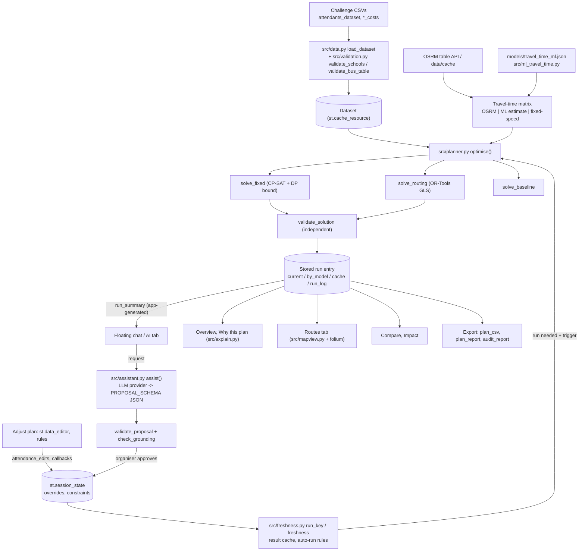

# Campus Cruise — Project Technical Report

Prepared on 2026-10-24 from the repository as it stands after the explainability, interactive-map,
assistant and ML travel-time work. Every statement below was checked against the source code, the
data files, the saved outputs in `demo_output/`, and test and solver runs made while writing it.
Where something could not be verified, the report says so.

**How to read the evidence labels**

| Label | Meaning |
|---|---|
| **Verified (code)** | Read in the source file and function named |
| **Verified (run)** | Reproduced by running the code during this audit |
| **Saved output** | Read from a file in `demo_output/` written by an earlier run; not re-run |
| **Illustrative** | Hypothetical numbers made up to explain an idea; not project results |
| **Not implemented** | Searched for and not found in the code |

---

## Contents

1. [Project overview](#1-project-overview)
2. [Technology stack](#2-technology-stack)
3. [Optimisation models and algorithms](#3-optimisation-models-and-algorithms)
4. [AI vs machine learning vs optimisation](#4-ai-vs-machine-learning-vs-optimisation)
5. [The mathematics](#5-the-mathematics)
6. [Worked examples](#6-worked-examples)
7. [Real project results](#7-real-project-results)
8. [Data flow and architecture](#8-data-flow-and-architecture)
9. [Dashboard functionality](#9-dashboard-functionality)
10. [Testing, validation and reliability](#10-testing-validation-and-reliability)
11. [Responsible AI, privacy and limitations](#11-responsible-ai-privacy-and-limitations)
12. [Presentation and judge questions](#12-presentation-and-judge-questions)

---

## 1. Project overview

### In simple English

Sixty schools are sending 1,244 pupils and staff to an event at the Principality Stadium in
Cardiff. The simplest plan is one bus per school: 60 buses. Campus Cruise works out which schools
should share a bus, and what size each bus should be, so the whole trip costs as little as
possible. A school's group is never split between two buses, and no bus is ever overfilled.

Organisers can change how many people each school brings, add rules ("these two schools must share
a bus", "this school travels alone"), compare plans, look at every bus on a map, ask questions in
plain English, and download the plan and an audit report. Every plan is checked by separate code
before it is shown or exported.

**Who uses it:** event and school-trip organisers. **Who benefits:** schools (lower cost per
attendee), organisers (less manual planning, a checked plan), and potentially the event (fewer
vehicles; emissions are not measured).

**Inputs:** the four challenge CSV files (pickup points with coordinates and head counts; bus prices
three ways), optional attendance edits and sharing rules, a cost model and a time limit.

**Outputs:** a bus plan (which schools on which bus, bus size, pickup order, cost per bus, each
school's cost share), savings against the one-bus-per-school baseline, solver status, a map, a
comparison with earlier plans, CSV and Markdown exports and an audit report.

### Technical explanation

Campus Cruise is a Streamlit application over a small Python optimisation package (`src/`). It
solves a **mixed-fleet bin-packing problem** (fixed price per bus) exactly with OR-Tools **CP-SAT**,
and an **open capacitated vehicle-routing problem with a heterogeneous fleet** (price per mile or
per hour) heuristically with the OR-Tools **routing library and guided local search**. Travel
times come from the public **OSRM** road-routing service (cached), a labelled fixed-speed estimate,
or a labelled experimental **ridge-regression** approximation of OSRM. An independent validator
(`src/validation.py`) recomputes every plan. An optional **LLM assistant** (OpenAI or Anthropic)
converts plain-English requests into a strict-JSON proposal that code validates and an organiser
must approve before the optimiser runs.

End to end: `load_dataset` validates the CSVs → the organiser picks a model and limit → `optimise`
builds the distance/time matrix and calls the right solver → the solver's plan goes through
`validate_solution` → the result is stored in session state with an input fingerprint → the
dashboard, map, explanation and exports all read that stored result.

**Why it is useful:** the number of ways to group 60 schools is astronomically large; manual
planning cannot search it. The fixed-price result is *provably* the cheapest, routing results are
clearly labelled as best-found, invalid plans are blocked, and every figure traces to the data.

---

## 2. Technology stack

Versions from `requirements.txt` (pinned) and the project virtual environment (`.venv`, Python
3.11.5; the file says "Tested with Python 3.11.5 on Windows 11"; there is no `python_requires`).

| Technology | Where used | Role |
|---|---|---|
| Python 3.11 | everywhere | Language |
| **Streamlit 1.66.0** | `app.py` | UI: sidebar, tabs, `st.data_editor`, `st.popover` chat, `st.cache_data`/`st.cache_resource`, session state; `streamlit.testing.v1.AppTest` for headless UI tests |
| **OR-Tools 9.15** (`ortools.sat.python.cp_model`) | `src/solvers.py: solve_fixed` | CP-SAT constraint solver for the fixed-price model |
| **OR-Tools routing** (`pywrapcp`, `routing_enums_pb2`) | `src/solvers.py: solve_routing` | Vehicle-routing search with guided local search for distance and time models |
| protobuf 6.33 | indirect | Required by OR-Tools |
| **numpy 2.4** | matrices, ML | Distance/time matrices; ridge regression in `src/ml_travel_time.py` (no scikit-learn) |
| **pandas 3.0** | data, reports | CSV parsing, tables, exports |
| **requests 2.34** | `src/distances.py` | Calls OSRM `table` (travel-time matrix) and `route` (road paths) services |
| Haversine (own code) | `src/distances.py: haversine_miles` | Straight-line miles; no geo library |
| **folium 0.20 + streamlit-folium 0.27** | `app.py: draw_map` | Leaflet map; optional (the app falls back to tables if missing) |
| tabulate 0.10 | `DataFrame.to_markdown` | Markdown tables in exports |
| **pytest 9.1** | `tests/` | Test framework |
| **openai 3.37 / anthropic 2.3** | `src/assistant.py` | Optional LLM providers for the assistant |
| JSON files | `data/cache/`, `models/` | OSRM cache; ML artefact. No database |
| `.streamlit/config.toml`, `secrets.toml` | config | Usage statistics off; API keys (git-ignored) |

**Not present:** scikit-learn, PyTorch/TensorFlow, any database, Docker or cloud deployment
configuration, authentication. Deployment is local (`streamlit run app.py`).

---

## 3. Optimisation models and algorithms

### Which algorithms exist (checked against the brief)

| Asked about | Status | Where |
|---|---|---|
| OR-Tools CP-SAT | **Implemented** | `solve_fixed` (fixed model, two stages) |
| Guided Local Search | **Implemented** | `solve_routing`: `LocalSearchMetaheuristic.GUIDED_LOCAL_SEARCH` |
| Other routing search strategies | First-solution strategy `PATH_CHEAPEST_ARC` is set but is used **only** if the hand-built start plan is rejected; normally search starts from that plan. No simulated annealing, tabu search or MIP | `solve_routing` |
| Dynamic-programming lower bound | **Implemented** (fixed model) | `seat_cover_lower_bound` |
| Warm starting | **Implemented** | `repair_plan`; CP-SAT hints (fixed); `ReadAssignmentFromRoutes` start (routing) |
| Reuse of previous solutions | **Implemented** | Session result cache keyed by input fingerprint (`src/freshness.py`) |
| Independent validation | **Implemented** | `validate_solution`, run inside `_finish` on every plan |
| Exact pickup ordering | Partly: brute-force permutations up to 8 stops, nearest-neighbour above | `order_stops` (fixed model display; warm-start/start plans) |

### Model 1 — Fixed cost per bus

1. **Name:** Fixed cost per bus (`"fixed"`).
2. **Source:** `src/solvers.py: solve_fixed`; entry via `src/planner.py: optimise`.
3. **Algorithm:** CP-SAT (OR-Tools) exact model, symmetry-free "leader" formulation, then a second
   lexicographic CP-SAT stage.
4. **Objective:** minimise total rental cost Σ price(bus size). Location is not part of the cost.
5. **Decision variables:** `x[i,j]` (school *i* rides the bus led by school *j*, only for *j ≤ i*
   in size order); `z[j,t]` (the bus led by *j* has size *t*); `count[t]` (number of buses of size *t*).
6. **Hard constraints:** each school on exactly one bus; a bus exists only if its leader rides it;
   capacity; a bus size smaller than its leader is never used; organiser must-share, cannot-share
   and solo rules; redundant cuts (total seats ≥ total attendees; cost ≥ lower bound).
7. **Soft preferences:** stage 2 only: among plans with the stage-1 cost, minimise the straight-line
   miles between each school and its bus leader ("group nearby schools"). It can never raise cost.
8. **Input:** schools (id, coordinates, attendees), fixed prices, constraints, time limit, optional
   warm-start plan.
9. **Output:** `Solution` with routes (stops in display order, size, attendees, miles for display,
   cost), status, runtime, notes; plus baseline.
10. **Configuration:** 8 search workers, seed 42, costs ×100 to integers; stage 1 gets 70% of the
    limit (min 1 s); stage 2 gets what is left (skipped below 0.5 s). Default limit 20 s.
11. **How a solution is generated:** pre-checks (`check_constraints`, school larger than every bus →
    INFEASIBLE with reasons); build model; optional hints from the repaired previous plan; solve
    with a callback that stops as soon as a plan reaches the lower bound; stage 2; order stops;
    validate.
12. **Feasibility/optimality:** OPTIMAL if CP-SAT reports OPTIMAL **or** the best cost equals the
    DP seat-cover lower bound; FEASIBLE (with the best bound in the notes) if time ran out first;
    INFEASIBLE if CP-SAT proves no assignment exists; NO_SOLUTION if no plan was found in time;
    INVALID if the validator rejects the plan.
13. **Limitations:** model size grows as O(n²) variables; pickup order is display-only; unlimited
    buses assumed; very short limits can end FEASIBLE (seen in this audit: a 5 s run on a busy CPU
    returned 1,915 vs the 1,875 bound, correctly labelled not proven).
14. **Worked example:** §6.1.

### Model 2 — Straight-line distance × rate per mile

1. **Name:** `"distance"`. 2. **Source:** `solve_routing` (model `"distance"`), matrix from
   `straight_line_matrix` (haversine).
3. **Algorithm:** OR-Tools routing library; guided local search from a valid start plan.
4. **Objective:** minimise Σ over buses of rate(size) × (miles from first pickup through each stop to
   the stadium). No cost before the first pickup, no return trip (challenge rules).
5. **Decision variables (inside OR-Tools):** successor of each node per vehicle, vehicle of each node.
   Fleet: for each size, one vehicle per school that fits it, so the fleet is effectively unlimited.
6. **Hard constraints:** capacity dimension per vehicle; every school visited once (routing default);
   must-share / cannot-share / solo as equalities/inequalities on `VehicleVar`.
7. **Soft preferences:** none.
8. **Input:** schools, per-mile rates, a miles matrix (schools then stadium), constraints, limit,
   optional warm start.
9. **Output:** `Solution` (routes in pickup order with miles and cost), status FEASIBLE.
10. **Configuration:** costs ×1000 to integers; virtual start node with zero-cost arcs to every
    school ("starts at its first pickup"); end node = stadium; default limit 300 s (whole limit used).
11. **How:** start plan = each must-share group on its own cheapest bus (or the repaired previous plan);
    `SolveFromAssignmentWithParameters`; read routes; recompute cost; validate.
12. **Optimality:** never claimed. Status is always FEASIBLE when a plan is found ("heuristic").
13. **Limitations:** straight-line miles, not road miles; heuristic, so reruns can differ; quality
    depends on the time limit.
14. **Worked example:** §6.2.

### Model 3 — Travel time × rate per hour

Same as Model 2 (`solve_routing`, model `"time"`, `metric_unit="hours"`) with a travel-time matrix
instead of miles:
- **Sources** (`app.py: get_time_matrix`, `src/distances.py: road_time_matrix`): OSRM `table`
  service (live or cached in `data/cache/`); fixed-speed estimate (miles × 1.3 / 35 mph, labelled
  APPROXIMATE); or the experimental ML estimate (labelled ML ESTIMATE). Times can be asymmetric;
  leg direction is respected.
- The matrix source is stored on the solution and shown on every page, export and summary.
- **Limitations:** OSRM durations are free-flow road estimates (no traffic, no dwell time); the
  public server is rate-limited.

### The baseline (all models)

`solve_baseline`: each school with attendees rents its own cheapest bus that fits and drives
straight to the stadium, priced with the same rates and matrix as the model. Status OPTIMAL by
construction (it is a fixed rule, not a search).

### How the three models differ

| | Fixed | Distance | Time |
|---|---|---|---|
| Cost depends on | Bus sizes only | Sizes and straight-line miles | Sizes and driving hours |
| Pickup order matters | No (display only) | Yes | Yes |
| Solver | CP-SAT (exact) | Routing + GLS (heuristic) | Routing + GLS (heuristic) |
| Can prove optimal | Yes | No | No |
| Default limit | 20 s | 300 s | 300 s |

---

## 4. AI vs machine learning vs optimisation

| Category | Status | What exactly |
|---|---|---|
| Traditional (symbolic) AI | **Implemented** | Constraint programming and search are classic AI techniques; rule-based validation of LLM proposals |
| Constraint programming & combinatorial optimisation | **Implemented** | CP-SAT model for the fixed model; DP lower bound |
| Heuristic search | **Implemented** | Guided local search (metaheuristic) in OR-Tools routing |
| Machine learning | **Partially implemented (experimental)** | One ridge-regression model approximating OSRM travel-time *estimates*; grouped cross-validation; JSON artefact; opt-in only |
| Deep learning | **Absent** | No neural networks |
| Generative AI / LLMs | **Implemented (optional)** | OpenAI or Anthropic via official SDKs, strict JSON schema, used for request interpretation and read-only explanations |
| Conventional maths/geography | **Implemented** | Haversine distances, cost arithmetic, savings and utilisation formulas |

**Is there a trained model?** One: `models/travel_time_ml.json`.
- **Training data:** the cached OSRM matrix `data/cache/osrm_1965645e223a1b27.json` (61 points, 3,600
  school→school/stadium pairs). Target = OSRM estimated duration. **There is no observed journey data
  in the repository** (no trip logs, timestamps, traffic or weather) — verified by
  `data_readiness()`.
- **Inference pipeline:** `TravelTimeModel.predict_hours` builds a full matrix (finite, ≥ 0, zero
  diagonal). Used only when the organiser selects it and only if it beat the baseline on held-out schools.
- **Evaluation:** 5-fold CV grouped by school (§7.3).
- **What it is not:** a predictor of real journey times. CP-SAT and GLS are **not** trained models.

### The LLM assistant (verified in `src/assistant.py`, `app.py`)

- **Providers/models:** OpenAI Chat Completions (`gpt-4.1-mini` default) or Anthropic Messages
  (`claude-opus-5-5` default). Chosen by `provider_from_config`: `CAMPUS_CRUISE_LLM_PROVIDER`, else
  OpenAI if `OPENAI_API_KEY` is set, else Anthropic. Model override `CAMPUS_CRUISE_LLM_MODEL`.
  This machine's `secrets.toml` holds an OpenAI key (the live check in this session used
  `gpt-4.1-mini`).
- **Where calls happen:** `OpenAIProvider.complete_json` / `AnthropicProvider.complete_json`, called
  only from `assist()`, which the app calls only when the organiser sends a message.
- **Prompts and structured output:** a fixed system prompt; the user message is `<context>` JSON
  (school ids and head counts, bus prices, rules, figures of runs made) + `<request>`. Output is
  forced to `PROPOSAL_SCHEMA` (strict JSON schema): request type (8-value allowlist), summary,
  answer, cost model, attendance changes, sharing rules, clarification question, soft preferences
  (`group_nearby`, `fewer_buses`).
- **Actions it can propose:** run a model; set attendance for named schools; add must-share /
  cannot-share / solo rules. Read-only: explain, compare. Others: clarify, grouping preference
  (explained, not applied), unsupported. **It cannot execute code, call tools or change state.**
- **Connection to the optimiser:** after the organiser clicks *Approve and run*,
  `assistant_approve` re-validates the proposal against current inputs, applies it to session state
  and sets a flag; the normal run path calls the same `optimise()` as the Run button; the result goes
  through the same validator; the app (not the LLM) writes a run summary into the chat from the
  stored result (`src/explain.py: run_summary`).
- **Validation:** `validate_proposal` — ids must exist, attendance a whole number ≤ largest bus and
  ≤ 500, rules with the right number of distinct schools, no conflicts (`check_constraints`), model
  available, nothing-would-change detection, preferences mapped honestly. Read-only answers pass
  `check_grounding`: every number must appear in the context/request; "optimal" claims about
  unproven plans are withheld. This is a heuristic, not a proof.
- **Failures:** missing key → `AssistantUnavailable`, chat disabled, rest of app works. Auth, rate
  limit, timeout, connection, HTTP errors, refusals, truncation, invalid JSON → `AssistantError`
  with a plain message. Any other exception is caught in `assist()`.

---

## 5. The mathematics

Notation: schools *i* = 1..n with attendees *aᵢ*; bus sizes *t* ∈ T = {15, 35, 50}; price *cₜ*
(per bus, per mile or per hour); event = stadium.

**Fixed model** (`solve_fixed`, schools sorted largest first; *x* defined only for *j ≤ i*):

```
minimise    Σⱼ Σₜ cₜ · z[j,t]                       total rental cost
subject to  Σ_{j≤i} x[i,j] = 1           ∀ i        every school on exactly one bus (never split)
            Σₜ z[j,t] = x[j,j]           ∀ j        bus j has one size iff its leader j rides it
            x[i,j] ≤ x[j,j]              ∀ i > j    nobody rides a bus that does not exist
            Σ_{i≥j} aᵢ x[i,j] ≤ Σₜ t · z[j,t]   ∀ j  capacity
            z[j,t] = 0  if t < aⱼ                    a bus smaller than its leader is useless
            Σₜ t · countₜ ≥ Σᵢ aᵢ                   redundant: enough seats in total
            cost ≥ LB                                redundant: DP lower bound
```

*x[i,j]* = 1 if school *i* rides the bus "led" by school *j* (its first, largest member). The leader
trick gives each grouping exactly one labelling, removing symmetric duplicates.

**Seat-cover lower bound** (`seat_cover_lower_bound`, exact DP, unbounded knapsack form):

```
best[0] = 0;   best[s] = min over t ( best[max(0, s − t)] + cₜ )    for s = 1 .. A + max(T)
LB = min_{s ≥ A} best[s],   A = Σᵢ aᵢ
```

The cheapest multiset of buses with at least A seats. Any valid plan rents such a set, so its cost
is ≥ LB. If a plan costs exactly LB it is optimal. For the real data: A = 1,244 → 25 × 50 seats =
1,250 → LB = 25 × 75 = **1,875** (verified by running the function).

**Routing models** (`solve_routing`, `route_metric`): for a bus of size *t* with pickup order
s₁ → s₂ → … → s_k → event:

```
route length  L = Σ_{m=1}^{k−1} d(s_m, s_{m+1}) + d(s_k, event)      (miles or hours)
route cost    = c_t · L
total cost    = Σ over buses of c_t · L                               (minimised)
```

*d* = haversine miles (distance) or travel hours (time). No cost before s₁, no return trip. Capacity:
Σ attendees on a bus ≤ t. Same school-once and organiser rules as above.

**Haversine** (`haversine_miles`), R = 3,958.7613 miles:
`d = 2R · asin( √( sin²(Δφ/2) + cos φ₁ cos φ₂ sin²(Δλ/2) ) )`.

**Fixed-speed time estimate:** `hours = miles × 1.3 / 35`.

**Reporting formulas** (`src/report.py`):

```
saving         = baseline cost − optimised cost
saving %       = saving / baseline cost × 100        (None if baseline = 0)
cost/attendee  = total cost / attendees              (None if 0 attendees)
utilisation    = Σ attendees on buses / Σ seats on buses
buses removed  = baseline buses − optimised buses
school share   = bus cost × school attendees / bus attendees
```

**ML model** (`fit_ridge`): standardised features z, unpenalised intercept ȳ;
`β = (ZᵀZ + αI)⁻¹ Zᵀ(y − ȳ)`, α = 1; prediction `ŷ = z·β + ȳ`, clipped at 0.
Metrics: MAE = mean|ŷ − y|, RMSE = √mean(ŷ − y)² (minutes); MAPE only for pairs over 5 minutes.

---

## 6. Worked examples

All examples in 6.1–6.4 are **Illustrative** (made-up schools A, B, C), but 6.1, 6.2 and 6.5 were
run through the real project code during this audit (synthetic data from `tests/conftest.py`).

### 6.1 Fixed model chooses bus sizes

Schools A = 30, B = 20, C = 12 people. Prices 15-seat 40, 35-seat 60, 50-seat 75.
- Baseline: A on a 35 (60), B on a 35 (60), C on a 15 (40) → **160**.
- Options: A+B = 50 fits a 50-seater exactly (75); C alone on a 15 (40) → **115**. A+C = 42 on a 50
  (75) + B on a 35 (60) = 135. All three = 62 > 50: impossible.
- Lower bound for 62 seats: 50 + 15 = 65 seats for 115 (35 + 35 = 70 seats costs 120) → LB = 115.
- **Real run result:** `solve_fixed` returned OPTIMAL, 115: [50-seat: B, A], [15-seat: C]. The cost
  equals the bound, so it is proven cheapest.

### 6.2 Distance model compares routes

Illustrative miles: A–B 2, A–C 10, B–C 9, A→stadium 12, B→stadium 11, C→stadium 15. Per-mile
rates 15-seat 2.25, 35-seat 3.25, 50-seat 4.00.
- A+B on a 50-seater: order A→B→stadium = 2 + 11 = 13 mi; B→A→stadium = 2 + 12 = 14 mi. Choose 13 →
  4.00 × 13 = 52.00. C alone: 2.25 × 15 = 33.75. **Total 85.75.**
- Baseline: A 3.25 × 12 = 39.00, B 3.25 × 11 = 35.75, C 33.75 → **108.50**.
- **Real run result:** `solve_routing` returned exactly this plan (85.75, FEASIBLE: heuristic, not
  proven, although small cases are brute-force checked in tests).

### 6.3 Travel time can prefer a longer but faster route

Illustrative: two ways to sequence one 50-seat bus. Route X: 10 miles, 0.50 h (country lanes). Route
Y: 14 miles, 0.35 h (motorway). Distance model (4.00/mile): X = 40.00, Y = 56.00 → chooses X. Time
model (240/hour): X = 120.00, Y = 84.00 → chooses Y. Same schools, different "best" plan, because
each model minimises a different quantity.

### 6.4 Feasible is not optimal

Illustrative reasoning plus one real observation. A heuristic stops when time runs out; the plan
found is valid (feasible), but nothing proves no cheaper plan exists. **Real observation (this
audit):** a 5 s fixed run while the test suite was loading the CPU returned **1,915.00, FEASIBLE**
with the bound 1,875 in its notes; the 20 s default run returns 1,875.00 OPTIMAL. The app labelled
the first "Feasible (optimality not proven)" and the explanation said a cheaper plan may exist.

### 6.5 The validator catches invalid plans

A deliberately broken plan for A, B, C (fixed prices): Bus 01 = 35-seat with A and B (50 people);
Bus 02 = 15-seat with B (20). **Real `validate_solution` output:**
- `Bus 01: 50 attendees exceed capacity 35.`
- `B is on both Bus 01 and Bus 02 (school split or duplicated).`
- `Bus 02: 20 attendees exceed capacity 15.`
- `Schools not assigned to any bus: C`

Such a plan is marked INVALID, never shown as a plan, and cannot be exported.

### 6.6 How the LLM interacts with the optimiser

1. Organiser: "NP11 now brings 15 people."
2. LLM returns JSON: `request_type: attendance_change`, `attendance_changes: [{NP11, 15}]`.
3. `validate_proposal`: NP11 exists, 15 is whole, ≤ 50, no rule conflict → proposal table "NP11: 18 → 15".
4. Nothing changes until **Approve and run**. On approval: re-check, apply, run `optimise()`.
5. Validator passes → the app posts a factual summary (status, buses, cost vs baseline).
6. "NP11 brings 80 people" → refused: "80 attendees do not fit on the largest bus (50 seats), and a
   school group is never split." No Approve button appears.

Tested with a scripted fake model in `tests/test_floating_chat.py` and
`tests/test_assistant_planning.py`; checked live once in this session (§10).

---

## 7. Real project results

### 7.1 Data facts (Verified run, `load_dataset`)

- 60 pickup points (postcode outcodes), **1,244 attendees**, 0 rows excluded, no warnings.
- Smallest group 3, largest 42, mean 20.7, median 21. Groups ≤ 15: 15; 16–35: 43; > 35: 2.
- Straight-line miles to the stadium: 5.4 to 45.0 (mean 21.5). Cached OSRM road time to the stadium:
  0.32 to 1.54 h; the OSRM matrix is asymmetric (up to 0.08 h between directions).
- Prices: fixed 40 / 60 / 75; per mile 2.25 / 3.25 / 4.00; per hour 135 / 195 / 240 (15/35/50 seats).
- Every school fits a bus; no school needs splitting.

### 7.2 Optimisation results

Re-run during this audit (Verified run, 2026-10-24, default limits, supplied data, no edits or rules,
time model on the cached OSRM matrix, no network). The saved benchmark
(`demo_output/benchmark.md`, 2026-10-24 01:29) gave **identical costs, bus counts and statuses** for
all three models; only the fixed model's runtime differed (18.8 s saved vs 10.6 s now, CPU load).

| | Fixed | Distance | Time (OSRM, cached) |
|---|---|---|---|
| Status | **OPTIMAL (proven)** | FEASIBLE (heuristic) | FEASIBLE (heuristic) |
| Runtime / limit | 10.6 s / 20 s | 300.0 s / 300 s | 300.0 s / 300 s |
| Optimised cost | 1,875.00 | 2,787.25 | 6,667.72 |
| Baseline cost | 3,330.00 | 3,903.87 | 8,220.26 |
| Saving | 1,455.00 (43.7%) | 1,116.62 (28.6%) | 1,552.54 (18.9%) |
| Buses (baseline 60) | 25 | 33 | 37 |
| Bus mix | 25 × 50 | 16 × 50, 16 × 35, 1 × 15 | 12 × 50, 23 × 35, 2 × 15 |
| Cost per attendee | 2.68 → 1.51 | 3.14 → 2.24 | 6.61 → 5.36 |
| Seat utilisation | 68.0% → 99.5% | 68.0% → 90.5% | 68.0% → 86.7% |
| Route total (own metric) | 785.28 mi (display only) | 762.66 mi | 32.34 h |
| Lower bound | 1,875.00 (DP) = cost | none | none |
| Validator | passed | passed | passed |

1,244 attendees in every plan; all 60 schools served.

**Attendance-change scenario** (CF15 → 25, SA18 → 20; 1,283 attendees): fixed model at 20 s →
**1,950.00, 26 buses, FEASIBLE**, lower bound 1,935.00 — *not proven optimal* at this limit
(saving 1,420.00, 42.1% vs a 3,370.00 baseline). The README's older note reports the same 1,950 vs
1,935 at 60 s.

**Limits of these results:** one run per model on one machine; routing is heuristic (another run or
limit can differ); costs are in the challenge's units; nothing here is a real-world measurement.

**Why costs across models are not comparable:** each model prices a different quantity (per bus,
per straight-line mile, per driving hour) with its own price table. The challenge README says totals
"are not intended to be compared to each other". Compare each model only with its own baseline.

### 7.3 ML evaluation (Verified run, `python train_travel_time.py`)

5-fold CV grouped by school, seed 42, all 3,600 pairs scored once out of fold. Target = OSRM estimate.

| Method | MAE (min) | RMSE (min) | MAPE (pairs > 5 min) |
|---|---|---|---|
| Fixed-speed formula (existing fallback, not fitted) | 10.34 | 14.44 | 22.5% |
| Ridge, straight-line miles only | 7.63 | 11.49 | 19.6% |
| Ridge, all 5 features (selected) | 7.25 | 11.17 | 17.0% |

Most of the gain comes from calibrating speed (miles only). These numbers measure agreement with
OSRM, not with real journeys.

### 7.4 Assistant evaluation (Saved output, `demo_output/assistant_eval.json`, 2026-10-24 02:36)

OpenAI `gpt-4.1-mini`, 30 cases: request type correct **24/30**; approval offered exactly when expected
**29/30**; **1 approval counted unsafe** ("CF15 and CF38 travel alone" — the case expects a refusal of a
malformed one-rule-two-schools proposal; the live model's raw proposal was not saved, so it cannot be
checked whether it proposed two valid solo rules). That run predates the soft-preference field. The
offline suite (scripted model outputs through real validation) passes all 30 cases.

---

## 8. Data flow and architecture



- **Origin of data:** the CSVs in the project root, read as text and converted explicitly; bad rows
  are excluded with a warning; duplicate ids block optimisation; capacity is checked per model.
- **Matrices:** `straight_line_matrix` (haversine) for fixed (display) and distance; time model from
  `get_time_matrix` (OSRM via `road_time_matrix` with disk cache → fallback; or ML; or estimate).
- **Solver inputs:** `optimise()` receives the edited `Dataset` copy (`with_attendance`), the
  `Constraints`, limit, matrix and optional warm start.
- **Storage:** a run entry (result, model, overrides, constraints, dataset, settings, trigger, run
  number, time, key) in `ss.current`, `ss.by_model[model]`, `ss.result_cache[key]` (last 20,
  conclusive results only) and `ss.last_valid`; every attempt in `ss.run_log`.
- **Validation:** `_finish` calls `validate_solution` for every solver plan; the baseline is validated
  too; the audit report re-runs the validator.
- **Metrics/maps:** read only from the stored entry; map rows and tables come from the same
  `filter_routes` / `route_details` output.
- **Edits → recalculation:** editor callbacks update `overrides` before the script body; the input
  fingerprint changes; stale results are flagged; the fixed model auto-runs once per new fingerprint;
  routing models wait for a click.
- **Caching:** dataset (`cache_resource`), OSRM matrix (`cache_data` + disk), ML model
  (`cache_resource`), straight-line miles (`cache_data`), road paths (session + disk), results
  (session cache by fingerprint).
- **Exports:** `plan_csv`, `plan_report`, `audit_report`, `metrics_csv` — all refuse invalid plans.

---

## 9. Dashboard functionality

Seven tabs exist (verified in `app.py`), plus the sidebar and the floating assistant. The separate AI Assistant tab was removed on 2026-10-24: the floating assistant now holds everything it had (request box, proposal table, Approve/Reject, what is sent, history).

| Area | Purpose | Key controls / content |
|---|---|---|
| **Sidebar** | Run control | Cost model; time limit per model (5–600 s); travel-time source (time model); OSRM online toggle; warm start; auto re-optimise; Run optimiser; freshness status |
| **Header** | Page status | Brand, subtitle, one status badge: Plan up to date / Out of date / Settings changed / No valid plan / No plan yet |
| **Overview** | Headline result | Four cards (attendees, buses, total cost with baseline, savings); status badge (green only when proven optimal); run caption with search time; baseline-vs-optimised table incl. cost per attendee; "what this plan means"; expanders **Why this plan?**, How this plan was created, Validation and constraints |
| **Routes** | Inspect buses | Plan selector; bus filter; school finder; Show all; road-path toggle; folium map centred by `map_view` (colours, numbered pickups for 3 buses or fewer, popups, highlight) with the bus list or single-bus details beside it; bus details table; cost shares (expander) |
| **Adjust plan** | Inputs | Attendance editor (validated), reset; must share, must not share, own bus |
| **Compare** | Model and change review | All models run (current inputs; others listed as not evaluated); previous vs revised plan, input changes, schools whose bus changed; solver details and grouping differences (expander) |
| **Responsible AI** | Governance | Three principles; not-measured note; expanders: method explainers and status meanings, oversight, data protection, accessibility (proposed), Wales strategy quotes, proposed pilot |
| **Data & checks** | Source data | File checks; schools; bus prices; event; assumptions and **ML data audit and evaluation** (expanders) |
| **Reports** | Downloads | Plan CSV; plan report (Markdown); **audit report (Markdown)**; **model metrics (CSV)**; run log |
| **Assistant button** (bottom-right) | Chat | One typing bar at the top; answers below it, newest first; Clear, Approve/Reject, app-generated run summaries, what is sent, request history |

**Incomplete or proposal-only items (stated in the app itself):** accessibility constraint
(proposed, not implemented); final plan sign-off (procedure, not a feature); pilot (proposed, not
run); no access control.

---

## 10. Testing, validation and reliability

### 10.1 Test runs (Verified run)

Command: `.\.venv\Scripts\python.exe -m pytest -q` (Windows 11, Python 3.11.5).

| Run | Collected | Passed | Failed | Skipped | Time |
|---|---|---|---|---|---|
| Before the new features (baseline) | 253 | 253 | 0 | 0 | 8 min 40 s |
| First run after the changes | 292 | 290 | **2** | 0 | 9 min 46 s |
| Final run (after the fix) | **293** | **293** | **0** | **0** | 11 min 8 s |

The two failures were a real bug found by existing tests: the map's *Plan shown* list used labels
containing the run number, which changes after every run, so Streamlit lost the selection. Labels
were made stable and a regression test was added. No test was deleted or weakened; three existing
assertions were updated earlier in the session where behaviour intentionally changed (automatic
re-optimisation for the fixed model, result reuse on undo).

Tests per file: `test_assistant.py` 69, `test_fixed_solver.py` 33, `test_attendance_reoptimisation.py`
29, `test_impact_and_limits.py` 18, `test_warm_start_and_paths.py` 17, `test_ml_travel_time.py` 15,
`test_cost_calculation.py` 14, `test_data.py` 14, `test_explain_and_map.py` 14,
`test_school_integrity.py` 13, `test_validation.py` 13, `test_optimisation_workflow.py` 12,
`test_assistant_planning.py` 11, `test_floating_chat.py` 11, `test_freshness.py` 6,
`test_app_flow.py` 4. Many are headless dashboard tests (Streamlit AppTest) that drive the real app
and solvers; the rest are unit and integration tests. All LLM and network calls in the suite are fakes.

### 10.2 Coverage by area

| Area | Examples (file) |
|---|---|
| Unit: maths and costs | haversine, route legs from first pickup, asymmetric legs, savings, shares (`test_cost_calculation.py`) |
| Exactness | fixed solver vs brute force on random instances with and without rules; routing vs brute force on a 5-school instance; DP bound vs enumeration (`test_fixed_solver.py`, `test_cost_calculation.py`) |
| Constraint validation | split, capacity, missing school, wrong cost/total, unknown size, rule violations (`test_validation.py`) |
| Solver timeouts | tiny time limit never claims optimal; time budgets respected; timeout keeps the last plan (`test_fixed_solver.py`, `test_attendance_reoptimisation.py`, `test_optimisation_workflow.py`) |
| External API failures | OSRM failures → labelled fallback, corrupt cache, road-path failures (fake sessions, no network); LLM auth/connection/timeout/refusal/invalid JSON (`test_school_integrity.py`, `test_warm_start_and_paths.py`, `test_assistant.py`) |
| Attendance-change regression | reductions, increases, multiple changes, zero, invalid values, editor parsing (`test_attendance_reoptimisation.py`, `test_app_flow.py`) |
| Workflow | freshness, cache, auto-run once, no reruns from widgets/chat (`test_freshness.py`, `test_optimisation_workflow.py`, `test_floating_chat.py`) |
| AI evaluation | 30-case offline set with adversarial outputs; app approve/reject; pipeline to the real optimiser; invalid-result reporting (`test_assistant.py`, `test_assistant_planning.py`) |
| Explainability and map | grounded explanation, report consistency, stale marking, filters synced (`test_explain_and_map.py`) |
| ML | features, folds, no training on held-out schools, metrics, artefact safety, integration (`test_ml_travel_time.py`) |

### 10.3 How invalid plans are blocked and failures handled

- `Solution.has_plan` is true only for OPTIMAL/FEASIBLE with routes and **no violations**;
  `plan_csv`, `plan_report`, `audit_report` and `impact_metrics` raise on anything else.
- INFEASIBLE explains why (capacity, rule conflicts); NO_SOLUTION and INVALID show no plan.
- Solver exceptions are caught; nothing stored is replaced; the error is shown (and posted to the
  chat for assistant runs). A timeout on inputs that already have a valid plan keeps that plan.

### 10.4 Manual checks this session

In Chrome against the running app: floating chat opens/closes, stays open across reruns, Escape
closes it; one live LLM request answered accurately ("no plan has been run yet"); fixed run 1,875
proven optimal; "Why this plan?" expands; school finder selects CF15 → Bus 04 (50/50, 4 schools,
21.4 mi, 96 min from cached OSRM) and zooms the map. Phone width was **not** verified.

### 10.5 Important missing tests

- No automated browser/visual test in the suite (AppTest is headless; layout and CSS are untested).
- No live OSRM or live LLM call in the suite (by design; `eval_assistant.py` is separate and costs credit).
- Routing optimality is only brute-force-checked on 5 schools; no larger benchmark against known optima.
- No performance/memory tests for larger events (e.g. 100+ points, where the public OSRM table limit applies).
- No multi-user/concurrency tests (single-user local app).

---

## 11. Responsible AI, privacy and limitations

**Implemented safeguards (verified in code):**
- Data processed: outcode, one coordinate per outcode, head counts, bus prices. **No student names,
  ages or individual records; no school names.**
- External transmission: OSRM receives coordinates (time model with OSRM online and no cache; road
  paths when toggled). The LLM provider receives request text, outcodes with head counts and bus
  assignments, prices, rules and plan figures — **no coordinates** (tested). Map tiles load from
  OpenStreetMap in the viewer's browser.
- Keys: read from environment or `.streamlit/secrets.toml` (git-ignored); never shown or logged;
  `secrets.example.toml` holds placeholders only.
- Human oversight: LLM proposals require explicit approval; re-validated at approval time; hard
  constraints are enforced by code, not by the prompt.
- Output validation: independent plan validator; grounding check on LLM answers; the post-run summary
  is generated by the app, not the LLM.
- Labelling: APPROXIMATE and ML ESTIMATE sources labelled everywhere; FEASIBLE never called optimal;
  stale results flagged.
- Usage statistics disabled in `.streamlit/config.toml`. Audit log holds no request text.

**Recommendations / future work (not implemented):** access control before sharing; deleting
`data/cache/` and exports after the event; self-hosted routing; accessible-bus constraint (needs
data); a formal final sign-off step; real journey logs for a genuine travel-time model.

**Claims not supported by the project:** GDPR compliance; data staying local (it does not when OSRM
or the LLM is used); carbon or fuel savings; real-world cost savings; traffic-accurate travel times;
formal approval workflows.

**Cannot currently do:** split a school; limit the fleet; return trips, dwell times, time windows,
driver hours; real traffic; road-distance pricing; soft preferences beyond the fixed model's
nearby tie-break; bus-count minimisation as an objective; multi-day or multi-event planning.

---

## 12. Presentation and judge questions

### A. One-minute explanation (non-technical)

"Sixty schools are bringing 1,244 people to a stadium in Cardiff. Booking one bus per school means 60
buses. Campus Cruise works out which schools should share and what size bus each group needs, without
ever splitting a school's group or overfilling a bus. With a fixed price per bus it finds a plan with
25 buses instead of 60 and 43.7% lower cost — and it proves no cheaper plan exists. Organisers can
change numbers or add rules, see every bus on a map, ask questions in plain English, and download a
checked plan. An AI assistant can suggest changes, but nothing happens until a person approves, and
every plan is double-checked by separate code."

### B. Three-minute technical explanation

1. **Problem.** Three cost models from the challenge. Fixed price: mixed-size bin packing. Per mile /
   per hour: open capacitated vehicle routing with a mixed fleet, starting at the first pickup.
2. **Exact model.** CP-SAT with a symmetry-free leader formulation, a dynamic-programming seat-cover
   lower bound that lets us stop and *prove* optimality, and a second stage that groups nearby
   schools without raising cost. Result: 1,875 = the lower bound, proven.
3. **Routing.** OR-Tools routing with a virtual start node (encodes "no cost before first pickup"),
   per-size cost callbacks, capacity dimension, organiser rules on vehicle variables, and guided local
   search from a valid start. Honest status: best found, never "optimal".
4. **Trust.** Every plan goes through an independent validator; results carry an input fingerprint,
   so stale results are flagged and repeats are reused; warm start keeps plans stable.
5. **AI layer.** An LLM turns plain English into a strict JSON proposal; code validates it; a person
   approves; the same optimiser runs; the app reports real figures.
6. **ML, honestly.** No real journey logs exist, so our ML model only approximates OSRM — it cuts
   the offline fallback's error from 10.3 to 7.3 minutes on held-out schools, and it is opt-in.

### C. Seven-minute pitch outline

| # | Time | Slide | Evidence | Demo action |
|---|---|---|---|---|
| 1 | 0:00–0:20 | Title | — | — |
| 2 | 0:20–0:55 | Problem: 60 schools, 1,244 people, never split | §7.1 data facts | — |
| 3 | 0:55–1:35 | Three models, two solvers | §3 table | — |
| 4 | 1:35–3:05 | Live demo | — | Fixed run → Why this plan → map: find CF15 → attendance edit auto-reruns → Compare |
| 5 | 3:05–3:50 | Assistant: request → validate → approve → optimise | §6.6 | Type "NP11 now brings 15 people." → Approve → app summary; "NP11 brings 80" refused |
| 6 | 3:50–4:30 | Results | §7.2 table | Point at proven optimal vs feasible |
| 7 | 4:30–5:05 | Trust: validator, freshness, tests | §10 counts | Export → audit report |
| 8 | 5:05–5:45 | Responsible AI and privacy | §11 | Data & checks: ML audit |
| 9 | 5:45–6:40 | ML honesty, limits, pilot | §7.3, §11 | — |
| 10 | 6:40–7:00 | Close | — | — |

Never run a 300 s routing search live; show the benchmark table.

### D. Technical interview preparation

1. **Why CP-SAT?** The fixed-price problem is pure bin packing with integer sizes and side rules;
   CP-SAT handles booleans, linear constraints and optimality proofs well, uses parallel workers, and
   accepts hints for warm starts.
2. **What is Guided Local Search?** A metaheuristic: local search that, when stuck in a local
   minimum, adds penalties to features (arcs) of the current solution so the search moves elsewhere.
   OR-Tools applies it to routing; it improves until the time limit.
3. **How do you prove optimality?** Two ways: CP-SAT's own proof (status OPTIMAL), or reaching the
   DP seat-cover lower bound — no plan can cost less than the cheapest set of buses with enough seats.
   For this data 1,244 people need ≥ 1,250 seats; 25 × 50-seaters at 75 = 1,875 and the plan costs 1,875.
4. **Why aren't routing results proven optimal?** Mixed-fleet capacitated routing is NP-hard; GLS gives
   no lower bound or certificate. We label results FEASIBLE ("best found in the time limit").
5. **Why do the three models give different plans?** Each minimises a different cost. Fixed price
   ignores location, so it fills big buses; per-mile/per-hour pay for every detour, so they group
   nearby schools and use more, smaller buses.
6. **Why is this an AI project?** Constraint programming and heuristic search are core AI/operations
   research methods; an LLM handles natural-language intent within guardrails; an experimental ML
   model estimates travel times. Each part is checked.
7. **Does it use machine learning?** One small, honest model: ridge regression approximating OSRM
   travel-time estimates, evaluated with grouped cross-validation, opt-in. No deep learning, and no
   model of real journey times because there is no such data.
8. **What role does the LLM play?** Interpreter and explainer only: it maps requests to a strict JSON
   proposal and answers read-only questions from app data. It cannot run code or change state.
9. **How are invalid plans detected?** `validate_solution` recounts passengers, checks capacity,
   splits, missing/extra schools, bus sizes, every rule, and recomputes every route length and cost.
   Any violation → INVALID → not shown, not exported.
10. **How are attendance changes handled?** Edits are validated (whole numbers ≥ 0), applied to a copy
    of the data, change the input fingerprint, flag stale results, and re-optimise (automatically for
    the fixed model). Warm start repairs the old plan so schools move only when needed.
11. **How are savings calculated?** Baseline (each school its own cheapest bus, same model) minus
    optimised cost; percentage of the baseline; None when the baseline is zero.
12. **What if the LLM invents a number?** `check_grounding` withholds answers with figures not in the
    data, or "optimal" claims about unproven plans. It is a heuristic safety net.
13. **What if OSRM is down?** Cached times are used; otherwise a labelled fixed-speed estimate (or the
    opt-in ML estimate). Failures never crash the app.
14. **What are the limits of the model?** Unlimited buses, straight-line distance for the distance
    model, no traffic/dwell/return trips, heuristic routing, costs in unit-less challenge prices.
15. **How would you evaluate a future ML model?** Collect real trip logs (departure time, observed
    duration); split by route and by time (train on earlier weeks, test on later) to avoid leakage;
    compare MAE/RMSE with OSRM and the formula; check calibration by time of day.
16. **How would it scale?** CP-SAT's leader model grows with n²; for hundreds of schools use a
    column-generation or decomposition approach (cluster, then pack). OSRM's public table caps at 100
    points: self-host OSRM. Routing GLS scales but needs longer limits.
17. **How would you measure real-world impact?** The proposed pilot: run alongside an organiser's
    usual planning and compare quoted cost, vehicles booked, planning hours, corrections, problems
    caught and organiser feedback.
18. **Why a virtual start node?** The challenge charges from the first pickup. Zero-cost arcs from a
    virtual node to every school let the solver choose the first pickup freely without charging a
    depot leg.
19. **Why is the fixed model's runtime close to 20 s if it proves optimality early?** After the
    proof, the remaining time goes to the tie-break stage that groups nearby schools at equal cost.
20. **Can the assistant bypass capacity?** No. Values above the largest bus are rejected in code;
    rule conflicts are checked; the optimiser and validator enforce capacity again.
21. **Why is the result reused when I undo an edit?** Results are cached by an input fingerprint;
    identical inputs mean an identical problem, so the stored validated plan is shown.
22. **How reliable are the routing numbers?** One run each; reruns can differ slightly (heuristic).
    Saved and re-run figures are both reported in §7.2.


---

## 13. Additions on 2026-10-25

Checked against the competition brief (`hcch-student-competition-details.pdf`).

- **Bus-distance impact** (`distance_impact` in `src/explain.py`). Bus-miles saved = baseline total
  bus-miles − plan total bus-miles, from the same straight-line matrix and route rule; driving hours
  likewise from the model's own or cached OSRM matrix. Shown in the Overview, both reports, the
  all-models summary and `benchmark.py`. Verified run, 2026-10-25: fixed 1,289.4 → 785.3 (−39.1%),
  distance 1,289.4 → 762.7 (−40.8%), time 1,289.4 → 856.6 (−33.6%). Not road miles; no emissions claim.
- **Scenarios** (`src/scenario.py`, Scenarios tab). Percentage attendance change (rounded up,
  exact integer maths), per-school values and a bus-price change; same optimiser and validator; stored
  apart from the current plan; adoption needs a confirmation tick and reuses the stored result (no new
  search); price scenarios cannot be adopted.
- **Plan report** now has a summary, approximation warnings, Responsible AI notes and bus-distance lines.
- **Responsible AI tab:** table of the brief's six principles (Transparency, Privacy, Accountability,
  Safety, Security, Fairness) with limits; potential beneficiaries (not measured, no endorsement);
  Well-being of Future Generations (Wales) Act link and Welsh-language gap, quoted from the National
  Events Strategy page (checked 2026-10-25); detailed pilot proposal (partner, data, process, feedback,
  consent).
- **Tests:** `tests/test_scenario_and_distance.py` (25 tests). Full suite on 2026-10-25: 323 tests,
  322 passed in one run plus the one fixed test re-run alone (25/25 in that file).
- **Generative AI disclosure:** README section, with a placeholder for the team to complete.
- **Still open:** no slide deck file; no co-production evidence (a pilot is proposed instead); no
  Welsh-language interface.

---

*Files referenced:* [`app.py`](app.py), [`src/solvers.py`](src/solvers.py),
[`src/validation.py`](src/validation.py), [`src/distances.py`](src/distances.py),
[`src/planner.py`](src/planner.py), [`src/data.py`](src/data.py), [`src/report.py`](src/report.py),
[`src/model.py`](src/model.py), [`src/assistant.py`](src/assistant.py),
[`src/freshness.py`](src/freshness.py), [`src/explain.py`](src/explain.py),
[`src/mapview.py`](src/mapview.py), [`src/ml_travel_time.py`](src/ml_travel_time.py),
[`train_travel_time.py`](train_travel_time.py), [`benchmark.py`](benchmark.py),
[`eval_assistant.py`](eval_assistant.py), [`tests/`](tests/).
