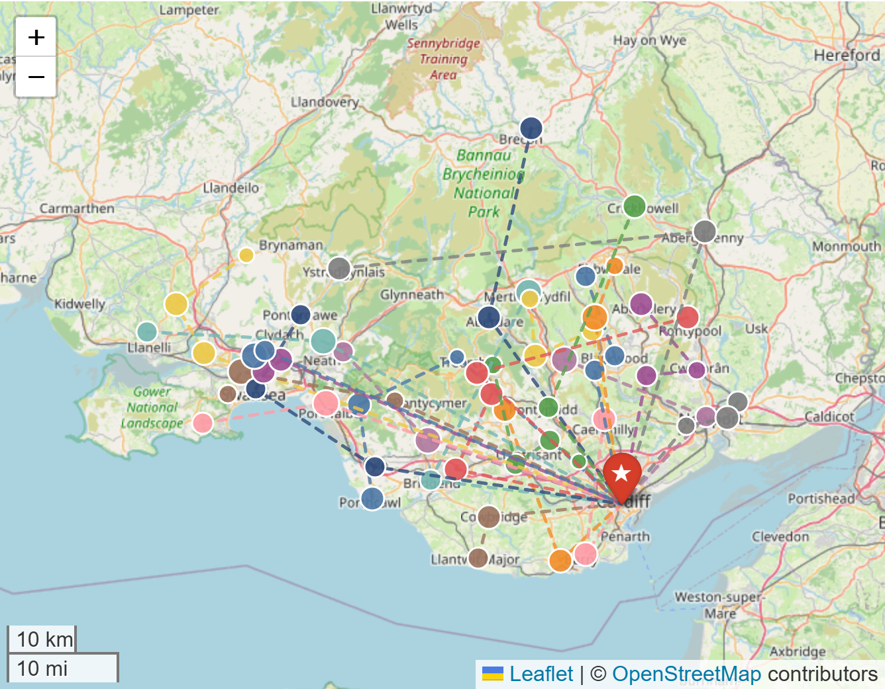
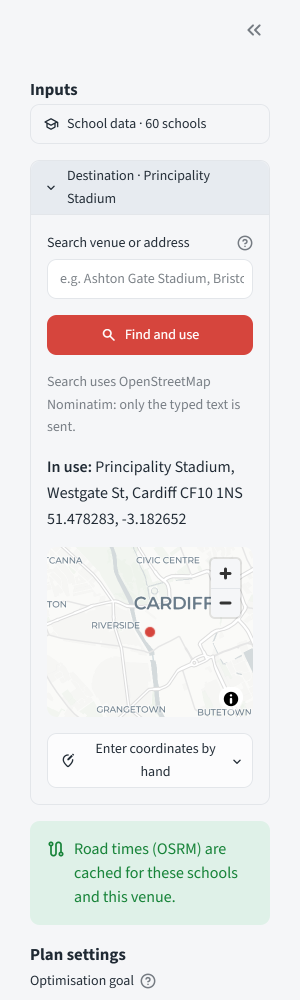
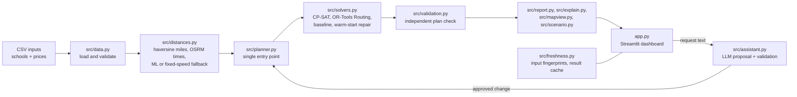
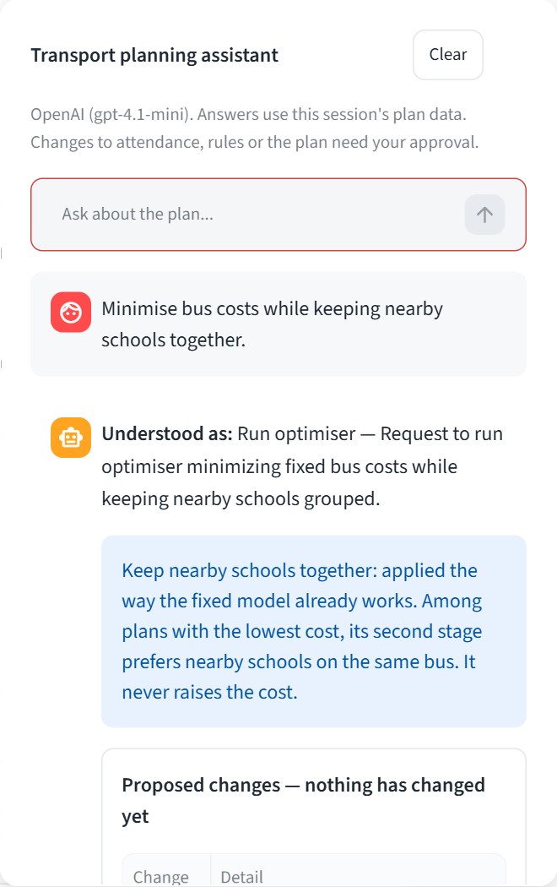

# Campus Cruise

**Shared school transport, optimised.** Campus Cruise works out which schools should share a bus,
and which bus size each group needs, so that every student reaches an event at the lowest total
transport cost. A school is never split between buses.

Built for **Technical Challenge 2: Travel Organizer** of the AI Pollination Student Competition 2026
(Cardiff University).



---

## Contents

1. [Project overview](#project-overview)
2. [Problem statement](#problem-statement)
3. [Proposed solution](#proposed-solution)
4. [Key features](#key-features)
5. [System architecture](#system-architecture)
6. [Optimisation models and algorithms](#optimisation-models-and-algorithms)
7. [Technology stack](#technology-stack)
8. [Project structure](#project-structure)
9. [Installation](#installation)
10. [Running the application](#running-the-application)
11. [Using the dashboard](#using-the-dashboard)
12. [Input data requirements and format](#input-data-requirements-and-format)
13. [Model outputs and evaluation](#model-outputs-and-evaluation)
14. [Testing](#testing)
15. [Limitations](#limitations)
16. [Future improvements](#future-improvements)
17. [Acknowledgements](#acknowledgements)
18. [Project authors](#project-authors)

---

## Project overview

Schools send groups of students to an event at Principality Stadium, Cardiff. Each school could book
its own bus, but many buses would run part-empty. Campus Cruise groups schools onto shared buses of
15, 35 or 50 seats and plans the pickup order, under three different pricing models supplied by the
challenge.

Several techniques work together, each doing what it is good at:

- **Constraint optimisation (Google OR-Tools)** builds every plan. An exact CP-SAT model handles the
  fixed-price-per-bus case and can prove its plan is the cheapest. OR-Tools Routing with guided local
  search handles the per-mile and per-hour cases.
- **Road travel times** come from the public OSRM routing service and are cached locally.
- **An experimental machine-learning estimate** (ridge regression) approximates OSRM road times when
  road data is unavailable.
- **An optional language-model assistant** turns an organiser's plain-English request into a
  structured proposal. The app validates every proposal and asks for approval before anything changes.
- **An independent validator** re-checks every plan without trusting the solver.

Campus Cruise is decision support: it proposes and checks plans, and the organiser decides.

## Problem statement

Given:

- 60 schools (identified by postcode outcode), each with coordinates and a number of attendees
  (1,244 in total);
- bus sizes of 15, 35 and 50 seats, with prices under three cost models:
  a fixed price per bus, a price per mile and a price per driving hour;
- one destination (Principality Stadium, 51.478283, -3.182652);

find the set of buses, their sizes and the schools each one collects, so that the total cost is as
low as possible and these hard rules hold:

- every school with attendees rides **exactly one** bus (a school group is never split);
- the attendees on a bus never exceed its seats;
- organiser rules (*must share*, *must not share*, *own bus*) are satisfied, or the app explains why
  they cannot be.

Route accounting follows the challenge data notes ([`docs/CHALLENGE_DATA.md`](docs/CHALLENGE_DATA.md)):
a bus starts at its first pickup, may stop at more schools, and ends at the stadium. No return trip
and no dwell time are charged. Leg direction matters, because road times are asymmetric.

## Proposed solution

1. **Load and validate** the school and price CSVs (or an uploaded school file).
2. **Build matrices** for the chosen cost model: straight-line (haversine) miles, or OSRM road
   driving times with a labelled fallback.
3. **Optimise** with the solver that fits the cost model:
   - fixed price per bus: exact CP-SAT bin-packing model;
   - price per mile or per hour: open capacitated vehicle routing with mixed bus sizes.
4. **Compare** with a baseline in which every school books its own cheapest bus.
5. **Validate** the plan independently, then show it on the dashboard with costs, savings, cost
   shares per school, a route map and an explanation of the result.

## Key features

- **Three cost models**: fixed price per bus (exact, can prove optimality), price per mile and price
  per driving hour (heuristic routing).
- **Mixed fleet** of 15-, 35- and 50-seat buses; an unlimited number of each size is assumed.
- **No-split rule**: each school travels together on one bus.
- **Organiser rules**: must share, must not share and own bus.
- **Independent validation** of every plan; invalid plans are never shown as valid or exported.
- **Warm start**: after an edit, the next run can start from the repaired previous plan.
- **Result freshness**: every input is fingerprinted, so the app always says whether the plan shown
  is up to date.
- **Explainability**: a "Why this plan?" panel separates computed facts from interpretation.
- **Interactive route map** (folium/Leaflet) with bus and school filters, and optional OSRM road paths.
- **Scenarios**: test attendance or price changes without touching the current plan.
- **Custom inputs**: upload another school CSV, or search for another destination by name or address.
- **Optional AI planning assistant** (OpenAI or Anthropic API) with validated, approval-gated proposals.
- **Reports**: plan CSV, plan report, audit report (Markdown) and model metrics (CSV), plus a run log.



## System architecture



`app.py` contains the user interface only. All planning logic lives in `src/`, so the same code is
used by the dashboard, the command-line demo, the benchmark and the tests.

## Optimisation models and algorithms

### Model 1: fixed price per bus (exact, CP-SAT)

This is mixed-size bin packing, solved with the OR-Tools CP-SAT solver using a symmetry-free
"leader" formulation. Schools are sorted largest first, and bus slot *j* exists only when school *j*
is its lowest-index passenger.

```
min  Σⱼ Σₜ costₜ · z[j,t]
s.t. Σ_{j≤i} x[i,j] = 1                       ∀i   (each school on exactly one bus)
     Σₜ z[j,t] = x[j,j]                       ∀j   (slot used iff its leader rides it)
     x[i,j] ≤ x[j,j]
     Σ_{i≥j} aᵢ x[i,j] ≤ Σₜ t · z[j,t]        ∀j   (capacity)
     Σₜ t · countₜ ≥ Σᵢ aᵢ,  cost ≥ LB        (redundant cuts)
```

- **LB** is a seat-cover lower bound (the cheapest set of buses that seats everyone), computed
  exactly by dynamic programming. A plan that reaches LB is optimal and the search stops.
- A second stage keeps the optimal cost fixed and minimises the distance between each school and the
  leader of its bus, so nearby schools are grouped without raising the cost.
- The status is **OPTIMAL** only when proven; a plan found at the time limit is **FEASIBLE** and is
  reported with the lower bound.

### Models 2 and 3: price per mile and per hour (OR-Tools Routing)

These are open capacitated vehicle routing problems with mixed bus sizes.

- **Virtual start node**: every bus leaves a virtual node through zero-cost arcs, which encodes "the
  bus starts at its first pickup". All routes end at the destination.
- **Arc costs**: one cost callback per bus size (rate × leg).
- **Fleet**: one candidate vehicle per school for each size that fits it.
- **Search**: `PATH_CHEAPEST_ARC` first solution (or the repaired previous plan), then
  `GUIDED_LOCAL_SEARCH` until the time limit. Results are always labelled FEASIBLE (heuristic).
- **Distance metric**: haversine (straight-line) miles, not road miles.
- **Time metric**: OSRM `table` service road driving times, cached in `data/cache/`. If OSRM is
  unavailable, the app uses the ML estimate or a fixed-speed estimate (miles × 1.3 ÷ 35 mph). Both
  are always labelled as estimates.

### Machine-learning travel-time estimate (experimental)

The data contains **no observed journey times**. The only travel-time data is the cached OSRM table.
`src/ml_travel_time.py` therefore fits a model that **approximates OSRM estimates from coordinates**,
as a better offline fallback than the fixed-speed formula. It is never presented as a predictor of
real journeys.

- Features: straight-line miles, √miles, each endpoint's distance to the stadium, and a
  destination-is-stadium flag. No feature uses OSRM output.
- Method: ridge regression in numpy; the artefact is plain JSON (`models/travel_time_ml.json`).
- Evaluation: 5-fold cross-validation grouped by school, on 3,600 school-to-school/stadium pairs.

### Baseline, validation and cost sharing

- **Baseline**: every school books its own cheapest bus that fits and drives straight to the stadium.
- **Validation** (`src/validation.py`): every school served once and not split, capacities respected,
  bus sizes valid, organiser rules satisfied, and every route cost recomputed from its legs.
- **Cost share per school** = bus cost × school attendees ÷ bus attendees.

A full technical walkthrough, including worked examples and the evidence behind each figure, is in
[`docs/TECHNICAL_REPORT.md`](docs/TECHNICAL_REPORT.md).

## Technology stack

| Area | Tools |
|---|---|
| Language | Python 3.11 (tested with 3.11.5 on Windows 11) |
| Optimisation | Google OR-Tools 9.15 (CP-SAT and Routing) |
| Data | pandas, numpy |
| Dashboard | Streamlit, folium, streamlit-folium |
| Routing data | OSRM public server (`table` and `route` services) |
| Geocoding | OpenStreetMap Nominatim (destination search) |
| Machine learning | numpy ridge regression |
| Optional assistant | OpenAI and Anthropic Python SDKs |
| Testing | pytest, Streamlit `AppTest` |

Exact versions are pinned in [`requirements.txt`](requirements.txt).

## Project structure

```
campus-cruise/
├── app.py                     Streamlit dashboard (user interface only)
├── demo.py                    command-line demo of all models
├── benchmark.py               reproducible one-run-per-model benchmark
├── eval_assistant.py          live evaluation of the AI assistant (needs an API key)
├── train_travel_time.py       retrains the experimental ML travel-time estimate
├── attendants_dataset.csv     schools: outcode, coordinates, attendees
├── fixed_costs.csv            price per bus, by size
├── direct_distance_costs.csv  price per mile, by size
├── time_costs.csv             price per hour, by size
├── requirements.txt           pinned dependencies
├── src/
│   ├── data.py                loading, Dataset, attendance overrides
│   ├── validation.py          input validation and independent plan checks
│   ├── distances.py           haversine, OSRM matrix and cache, labelled estimates
│   ├── geocode.py             destination search (Nominatim)
│   ├── ml_travel_time.py      data audit, ridge model, grouped cross-validation
│   ├── solvers.py             CP-SAT model, OR-Tools Routing, baseline, warm-start repair
│   ├── planner.py             single entry point: matrices, solve, baseline
│   ├── model.py               Solution, BusRoute and Constraints types
│   ├── report.py              savings, cost shares, comparisons, CSV/Markdown export
│   ├── explain.py             plan explanations, model summary, audit report
│   ├── scenario.py            attendance and price scenarios
│   ├── mapview.py             map filters and per-bus details
│   ├── freshness.py           input fingerprints, auto-run rules, result cache
│   └── assistant.py           AI assistant: providers, proposal validation, grounding check
├── models/
│   └── travel_time_ml.json    trained ML artefact (plain JSON)
├── data/cache/                bundled OSRM road-time matrix for the default schools
├── tests/                     pytest suite (unit, solver, data and dashboard tests)
├── docs/
│   ├── TECHNICAL_REPORT.md    full technical report
│   ├── CHALLENGE_DATA.md      challenge data notes (source of the route rules)
│   ├── Campus_Cruise_Pitch_Deck.pptx
│   └── images/                screenshots used in this README
└── .streamlit/
    ├── config.toml            Streamlit settings (usage statistics off)
    └── secrets.example.toml   template for optional API keys
```

The data CSVs stay in the project root because the loader (`src/data.py`) reads them from there.

## Installation

Requirements: Python 3.11 and Git. Use a virtual environment; nothing needs to be installed globally.

```bash
git clone https://github.com/Dhanushkalapati/campus-cruise.git
cd campus-cruise
```

**Windows (PowerShell)**

```powershell
python -m venv .venv
.\.venv\Scripts\Activate.ps1
python -m pip install -r requirements.txt
```

If PowerShell blocks the activation script, run `Set-ExecutionPolicy -Scope CurrentUser RemoteSigned`
once, or call `.\.venv\Scripts\python.exe` directly.

**Linux / macOS**

```bash
python3 -m venv .venv
source .venv/bin/activate
pip install -r requirements.txt
```

### Optional: AI assistant key

The assistant is the only part that needs a credential. Without a key, everything else works and the
assistant says it is not configured.

- Set `OPENAI_API_KEY` or `ANTHROPIC_API_KEY` as an environment variable, **or**
- copy `.streamlit/secrets.example.toml` to `.streamlit/secrets.toml` and add the key there.
  `secrets.toml` is git-ignored; never commit it.
- With both keys set, OpenAI is used unless `CAMPUS_CRUISE_LLM_PROVIDER=anthropic`.
  `CAMPUS_CRUISE_LLM_MODEL` overrides the default model.

## Running the application

```bash
streamlit run app.py
```

The dashboard opens at <http://localhost:8501>.

Other entry points:

| Command | What it does |
|---|---|
| `python demo.py` | Command-line demo: all models, an attendance change and re-optimisation (about 21 min) |
| `python demo.py --offline` | Same demo without OSRM (labelled estimate for the time model) |
| `python demo.py --time-limit 30` | Same time limit for every model, much faster |
| `python benchmark.py` | One run per model at the default limits (about 11 min); writes `demo_output/benchmark.md` and `benchmark.json` |
| `python train_travel_time.py` | Retrains the ML travel-time estimate from the cached OSRM data (no network) |
| `python eval_assistant.py` | Sends 30 test requests to the configured language model (needs a key; about 30 API calls) |

Default solver time limits: 20 s for the fixed model, 300 s for each routing model. The dashboard has
a slider for each (5–600 s).

## Using the dashboard

1. **Sidebar.** Choose the school data (bundled or uploaded CSV) and the destination. Pick an
   optimisation goal (fixed price per bus, price per mile, price per driving hour) and press
   **Run optimiser**. *Advanced settings* hold the time limit and, for the time goal, the
   travel-time source.
2. **Overview.** Attendees, buses, total cost against the baseline and savings, plus
   *Why this plan?*, *How this plan was created* and *Validation and constraints*.
3. **Routes.** The interactive map, one colour per bus. Filter by bus or find a school. Turn on
   **Road paths (OSRM)** to draw real road routes.
4. **Adjust plan.** Edit attendance and add *must share*, *must not share* or *own bus* rules. The
   fixed model re-optimises automatically; routing models wait for **Run optimiser**.
5. **Compare.** Every cost model run this session, and the previous plan against the current one.
6. **Scenarios.** Test attendance or price changes as a separate scenario, then adopt or discard it.
7. **Assistant** (button at the bottom-right). Type a request such as
   *"CF15 now brings 25 people"*; review the proposed change; **Approve and run** or **Reject**.
8. **Responsible AI.** How plans are made and checked, human oversight, data protection and limits.
9. **Data & checks.** File checks, schools, bus options and the travel-time / ML data audit.
10. **Reports.** Download the plan CSV, plan report, audit report and model metrics; view the run log.



## Input data requirements and format

| File | Columns | Units |
|---|---|---|
| `attendants_dataset.csv` | `outcode, latitude, longitude, attendants` | WGS84 degrees, people |
| `fixed_costs.csv` | `Bus size, Fixed price` | seats, cost units per bus |
| `direct_distance_costs.csv` | `Bus size, Price per mile` | seats, cost units per straight-line mile |
| `time_costs.csv` | `Bus size, Price per hour` | seats, cost units per hour |

- Schools are identified by postcode outcode; the data contains no school or student names.
- The data does not state a currency, so all costs are shown in **cost units**.
- The source CSVs are never modified. Attendance edits apply to a copy in the session.
- **Validation of the bundled files:** rows with invalid coordinates or negative or fractional
  attendance are excluded with a warning; duplicate school IDs block optimisation; invalid prices and
  bus sizes are excluded.
- **Uploaded school CSVs** use the same four columns (a template can be downloaded in the sidebar).
  They are stricter: any invalid row rejects the whole file, with row numbers. Uploads last for the
  browser session only.
- A school larger than the biggest bus (50) cannot be seated without splitting, so the app reports
  the plan as infeasible and explains why.

## Model outputs and evaluation

For each run the app reports the plan (buses, sizes, schools and pickup order), the total cost, the
baseline cost, savings, buses removed, seat utilisation, cost per attendee, each school's cost share,
straight-line bus-miles, driving hours (when travel-time data is available), the solver status and
the validation result.

**Results on the supplied data** (60 schools, 1,244 attendees), measured with `python benchmark.py`
on 2026-10-24 with the default limits (Windows 11, Python 3.11.5):

| Cost model | Optimised | Buses | Baseline | Buses | Savings | Status | Runtime |
|---|---|---|---|---|---|---|---|
| Fixed price per bus | 1,875.00 | 25 | 3,330.00 | 60 | 1,455.00 (43.7%) | **Proven optimal** | 18.8 s |
| Price per mile (straight line) | 2,787.25 | 33 | 3,903.87 | 60 | 1,116.62 (28.6%) | Feasible, heuristic | 300.0 s |
| Price per hour (OSRM road times, cached) | 6,667.72 | 37 | 8,220.26 | 60 | 1,552.54 (18.9%) | Feasible, heuristic | 300.0 s |

- **Why 1,875 is optimal:** 1,244 attendees need at least 25 buses (25 × 50 = 1,250 seats). Only 25
  fifty-seaters give 25 buses enough seats, and any plan with 26 or more buses costs more. CP-SAT
  proves the same result.
- Routing results come from a time-limited heuristic search, so repeated runs can differ slightly.
  They are valid plans but not proven to be the cheapest.
- Costs from different cost models are not comparable with each other.

**Bus distance** (`python benchmark.py --offline`, straight-line miles summed over buses, first
pickup to stadium):

| Cost model | Bus-miles, baseline → plan | Saved |
|---|---|---|
| Fixed price per bus | 1,289.4 → 785.3 | 504.1 (39.1%) |
| Price per mile | 1,289.4 → 762.7 | 526.7 (40.8%) |
| Price per hour | 1,289.4 → 856.6 | 432.8 (33.6%) |

**ML travel-time estimate** (`python train_travel_time.py`, 5-fold cross-validation grouped by
school; the target is OSRM's estimate, not observed journeys):

| Method | MAE (min) | RMSE (min) | MAPE (pairs > 5 min) |
|---|---|---|---|
| Fixed-speed formula (previous fallback) | 10.34 | 14.44 | 22.5% |
| Ridge, miles only | 7.63 | 11.49 | 19.6% |
| Ridge, all features (selected) | 7.25 | 11.17 | 17.0% |

**AI assistant:** `tests/assistant_eval_cases.py` contains 30 organiser requests (clear, ambiguous,
unsupported, invalid, capacity breaches, rule conflicts and adversarial model outputs). Offline, with
scripted model outputs, all 30 are handled as expected.

## Testing

```bash
python -m pytest -q
```

The suite has 392 tests and takes about 14 minutes on a laptop, because several tests run the real
solvers. It needs no network and no API key: OSRM and the language model are replaced by fakes.

Coverage includes:

- brute-force checks of the fixed solver on random small instances, with and without rules;
- a brute-force check of the routing solver on a 5-school instance;
- route-leg accounting, including asymmetric legs; baseline, savings and cost-share maths;
- malformed, empty and invalid data, capacity infeasibility and conflicting rules;
- time limits that never claim optimality; warm start and re-optimisation after edits;
- OSRM failures and fallbacks; geocoding; the ML model and its safe loading;
- scenarios, exports, and refusal to export invalid plans;
- the AI assistant (30-case set, malformed output, provider errors, approve and reject flows);
- headless dashboard flows with Streamlit `AppTest`.

## Limitations

- **Routing models are heuristic.** They return valid plans within the time limit but are not
  proven optimal, and repeated runs can differ slightly.
- **Distances are straight-line** (haversine) miles, not road miles. Travel times are OSRM road
  estimates; traffic, time of day, weather and dwell time at stops are not modelled.
- **No observed journey data** exists, so the ML model approximates OSRM, not real journeys. It was
  trained only on the 60 South Wales schools and Principality Stadium.
- **Unlimited fleet** of each bus size is assumed; driver hours and availability are not modelled.
- **Public services:** OSRM and Nominatim public servers are rate-limited and best-effort. Results
  are cached after the first successful call. More than 99 schools exceeds the OSRM table limit, and
  the time model then uses the labelled estimate.
- **Assistant grounding** is checked heuristically (numbers and "optimal" wording); it is not a proof.
- **No access control.** This prototype has no login, so it should not hold real personal data
  without one.
- **Fuel use and emissions** are not estimated; the data has no vehicle information.
- Results come from the supplied, fictional challenge data. No real-world pilot has been run.

## Future improvements

- Accessible-transport constraint (wheelchair spaces per school and per bus type).
- Road-distance pricing from a self-hosted routing server, which also keeps coordinates private.
- Real journey logs to train and evaluate a genuine travel-time predictor.
- Limited fleet sizes, driver hours and pickup time windows.
- Login and role-based access before handling real data.
- Fuel and emissions estimates once vehicle data is available.
- Welsh-language interface.
- A pilot with a Welsh event organiser to measure cost, planning time and organiser feedback.

## Acknowledgements

- The AI Pollination Student Competition 2026 organisers, for the challenge and the dataset.
- [Google OR-Tools](https://developers.google.com/optimization) for the CP-SAT and Routing solvers.
- [OSRM](https://project-osrm.org/) for road travel times, and
  [OpenStreetMap](https://www.openstreetmap.org/copyright) contributors for map data, tiles and
  Nominatim geocoding (© OpenStreetMap contributors, ODbL).
- [Streamlit](https://streamlit.io/), [folium](https://python-visualization.github.io/folium/) and
  [Leaflet](https://leafletjs.com/) for the dashboard and map.
- Generative AI tools were used as coding and writing aids. The project team reviewed, ran and tested
  all output.

## Project authors

Campus Cruise was created by:

| Name | Affiliation |
|---|---|
| Dhanush Kalapati | Cardiff University |
| Samyaka Nadavala | Cardiff University |
| Sathwika Orugonda | Cardiff University |

Authors are listed in alphabetical order by first name.
